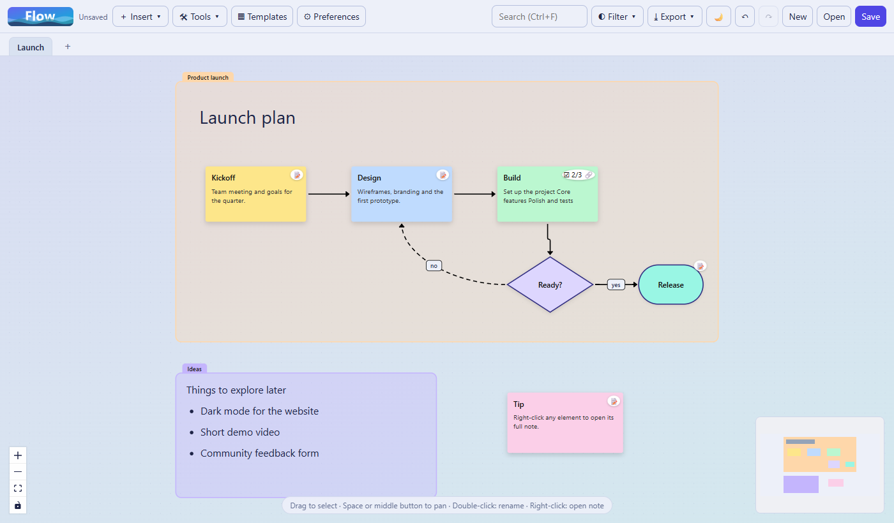
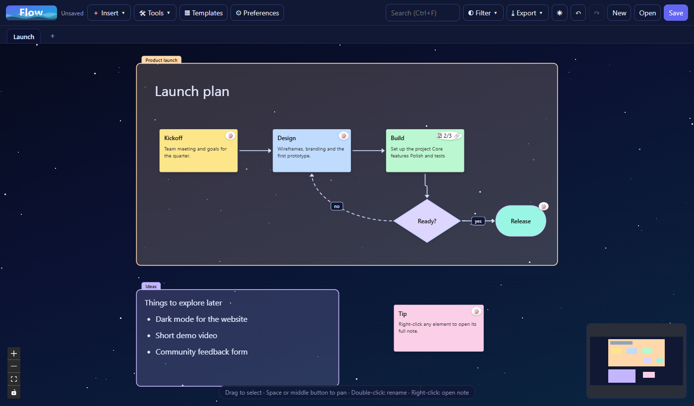

# Flow

**Diagramas interactivos, moodboards y notas enriquecidas en una sola app de escritorio.**

Crea un diagrama, adjunta todo el texto que quieras a cualquier elemento y ábrelo de nuevo con un clic derecho. Flow está pensado para cuando una caja en un diagrama no es suficiente: tu nodo puede contener una descripción completa, listas de tareas, enlaces a otros nodos e imágenes, sin salir del lienzo.

🌐 [English](README.md) · Español

<p align="center">
  
  
</p>

## Características

- **Diagramas interactivos.** Cada tarjeta tiene su propio título y descripción corta, que se editan en el lienzo (doble clic). Clic derecho sobre cualquier elemento abre una *nota ampliada* independiente, tipo publicación, con su propio título, portada, encabezados, listas, tareas, citas, enlaces e imágenes: la tarjeta se mantiene ordenada y el detalle queda a un clic. Los elementos muestran una insignia cuando tienen nota ampliada (y el progreso de tareas, como `☑ 2/5`).
- **Lienzo infinito** con cajas, formas (redondeada, píldora, elipse, rombo, hexágono), texto libre, notas adhesivas, imágenes y **secciones** (contenedores con título y texto propio que mueven su contenido).
- **Tableros Scrum como Trello.** Columnas To Do, In Progress y Done: arrastra las tarjetas entre ellas, reordénalas, añade nuevas y deja que crezcan con su texto. Cualquier nota adhesiva se puede soltar en una columna, y cualquier tarjeta se puede sacar.
- **Plantillas** de tablero Scrum, diagrama de flujo, mapa mental, línea de tiempo y moodboard.
- **Conectores** rectos, en ángulo o curvos, sin punta, con una o dos puntas, continuos o punteados, con etiquetas editables.
- **Dibujo a mano alzada** con colores y grosor, y borrador. Los trazos son elementos normales: se mueven, escalan y se deshacen.
- **Moodboards.** Pega imágenes desde el portapapeles o añádelas desde el disco (se comprimen automáticamente).
- **Varios tableros** en pestañas, guardados juntos en un único archivo `.flow`.
- **Productividad.** Deshacer/rehacer, copiar/pegar/duplicar, selección múltiple, alinear y distribuir, búsqueda (`Ctrl+F`) en títulos y notas, filtro por color, enlaces entre elementos.
- **Exportar** todo el tablero a PNG, SVG o PDF.
- **Dos temas**: uno *claro* y suave, y una *noche* estrellada, ambos con los colores del logo.
- **Preferencias** para ocultar el minimapa, los controles de zoom, las instrucciones, los puntos de fondo o las estrellas, ajustar a la cuadrícula y más.
- **Pregunta antes de salir** si tienes cambios sin guardar en un archivo.
- **Interfaz en inglés y español** (sigue el idioma del sistema; cámbialo en Preferencias).
- **Local y privado.** Todo se guarda en tu equipo. Sin cuentas ni red.

## Descarga

Descarga el instalador de Windows desde la página de [Releases](../../releases) o compílalo tú mismo (abajo).
Para probar, abre [`examples/demo.flow`](examples/demo.flow) con **Abrir**.

## Ejecutar desde el código

Requiere [Node.js](https://nodejs.org) 22 o superior.

```bash
npm install
npm run dev      # desarrollo con recarga en caliente
npm start        # compila y ejecuta la versión de producción
```

## Crear el instalador

```bash
npm run dist     # genera release/Flow-Setup-<versión>.exe (Windows, NSIS)
```

El instalador no está firmado, así que Windows SmartScreen puede mostrar un aviso la primera vez. Para macOS o Linux hay que ejecutar `electron-builder` en ese sistema operativo.

## Teclado y ratón

| Acción | Cómo |
| --- | --- |
| Abrir la nota ampliada de un elemento | Clic derecho |
| Renombrar en el lugar | Doble clic |
| Seleccionar varios | Arrastrar sobre el lienzo, o `Shift`+clic |
| Mover el lienzo | `Espacio` + arrastrar, o botón central |
| Zoom | Rueda del ratón |
| Deshacer / Rehacer | `Ctrl/Cmd+Z` / `Ctrl/Cmd+Shift+Z` |
| Copiar / Cortar / Pegar / Duplicar | `Ctrl/Cmd+C` / `X` / `V` / `D` |
| Seleccionar todo | `Ctrl/Cmd+A` |
| Buscar | `Ctrl/Cmd+F` |
| Guardar | `Ctrl/Cmd+S` |

## Pruebas

```bash
npm test            # pruebas unitarias (sanitización, guardias de IPC, utilidades, alineación)
npm run test:e2e    # compila y maneja la app real: seguridad, flujos de interfaz, exportación
```

## Diagnóstico

Si la app llegara a caerse, escribe un registro local (que no se envía a ningún sitio) en `%APPDATA%/flow/logs/flow.log` en Windows, y los informes de fallo nativos en la carpeta `Crashpad` contigua. Adjúntalos al reportar un problema.

## Seguridad

Flow trata los archivos `.flow` como entrada no confiable: se sanitizan al cargarlos (se descartan tipos desconocidos, imágenes remotas, colores inválidos y enlaces rotos, y se limitan los tamaños). El renderer corre aislado y en sandbox, bajo una CSP estricta, y solo puede escribir en archivos elegidos en un diálogo del sistema.

## Licencia

[MIT](LICENSE)
