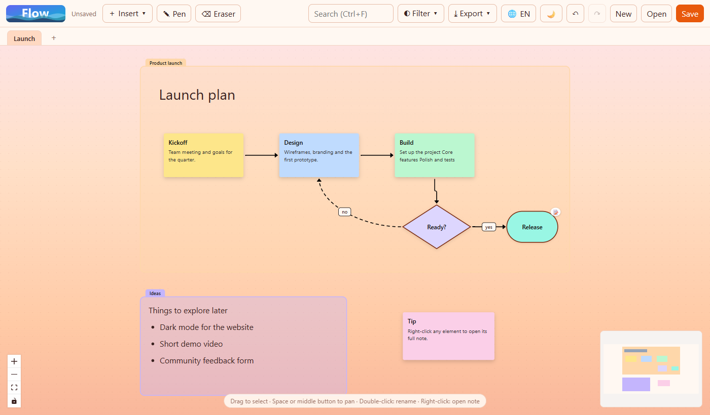
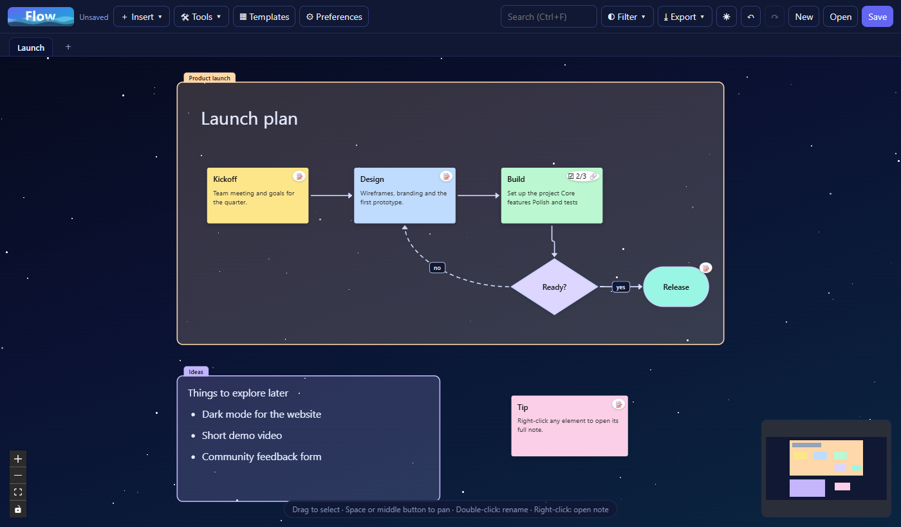

# Flow

**Interactive diagrams, moodboards and rich notes in one desktop app.**

Build a diagram, attach as much writing as you want to any element, and open it again with a right-click. Flow is made for the moment when a box on a diagram is not enough: your nodes can hold a full description, task lists, links to other nodes and images, without leaving the canvas.

🌐 English · [Español](README.es.md)

<p align="center">
  
  
</p>

## Features

- **Interactive diagrams.** Right-click any element to open a post-style editor with a title, cover image, headings, lists, task lists, quotes, links and images. Elements show a badge when they have a note (and task progress like `☑ 2/5`).
- **Infinite canvas** with boxes, rounded/pill/ellipse/diamond/hexagon shapes, free text, sticky notes, images and **sections** (titled containers with their own rich text that move their contents together).
- **Connectors** that are straight, elbow or curved, with no arrowhead, one or both ends, solid or dashed, and editable labels.
- **Freehand drawing** with pen colors and thickness, plus an eraser. Strokes are regular elements: move, resize, undo.
- **Moodboards.** Paste images from the clipboard or add them from disk (they are compressed automatically).
- **Multiple boards** in tabs, saved together in a single `.flow` file.
- **Productivity.** Undo/redo, copy/paste/duplicate, multi-select, align and distribute, search (`Ctrl+F`) across titles and notes, filter by color, links between elements.
- **Export** the whole board to PNG, SVG or PDF.
- **Two themes**: a warm *sunset* and a starry *night*.
- **English and Spanish** interface (follows your system language; switch it with the 🌐 button).
- **Local and private.** Everything is stored on your machine. No accounts, no network.

## Download

Grab the Windows installer from the [Releases](../../releases) page, or build it yourself (below).
Examples to try: open [`examples/demo.flow`](examples/demo.flow) with **Open**.

## Run from source

Requires [Node.js](https://nodejs.org) 22 or newer.

```bash
npm install
npm run dev      # development with hot reload
npm start        # build and run the production bundle
```

## Build the installer

```bash
npm run dist     # creates release/Flow-Setup-<version>.exe (Windows, NSIS)
```

The installer is not code-signed, so Windows SmartScreen may warn on first run. Building for macOS or Linux requires running `electron-builder` on that operating system.

## Keyboard and mouse

| Action | How |
| --- | --- |
| Open an element's note | Right-click |
| Rename in place | Double-click |
| Select several | Drag on the canvas, or `Shift`+click |
| Pan | `Space` + drag, or middle mouse button |
| Zoom | Mouse wheel |
| Undo / Redo | `Ctrl/Cmd+Z` / `Ctrl/Cmd+Shift+Z` |
| Copy / Cut / Paste / Duplicate | `Ctrl/Cmd+C` / `X` / `V` / `D` |
| Select all | `Ctrl/Cmd+A` |
| Search | `Ctrl/Cmd+F` |
| Save | `Ctrl/Cmd+S` |

## Tests

```bash
npm test            # unit tests (document sanitizing, IPC guards, utilities, layout)
npm run test:e2e    # builds, then drives the real app: security, UI flows, export
```

The end-to-end suite starts the actual Electron app and checks, among other things, that the Content Security Policy blocks inline scripts and network access, that the main process rejects invalid requests, and that a hostile `.flow` file cannot run code or reach the internet.

## Security notes

Flow treats `.flow` files as untrusted input. Files are sanitized on load (unknown element types, remote images, invalid colors and dangling links are dropped, sizes are capped). The renderer is sandboxed and context-isolated, runs under a strict CSP, and can only write to files chosen in a system dialog.

## Tech stack

[Electron](https://www.electronjs.org) · [React](https://react.dev) · [Vite](https://vite.dev) · [React Flow (@xyflow/react)](https://reactflow.dev) for the canvas · [TipTap](https://tiptap.dev) for rich text · [i18next](https://www.i18next.com) · [perfect-freehand](https://github.com/steveruizok/perfect-freehand) · [html-to-image](https://github.com/bubkoo/html-to-image) and [jsPDF](https://github.com/parallax/jsPDF) for export · [Vitest](https://vitest.dev).

Thanks to the React Flow team at [xyflow](https://xyflow.com): the library is MIT-licensed and powers the canvas here. If it is useful to you, consider [supporting them](https://reactflow.dev/pro).

## Project layout

```
electron/   main process, preload and IPC guards
src/        React app (canvas, nodes, edges, editor, i18n)
tests/      unit tests and end-to-end suite
scripts/    logo and icon generator
examples/   demo.flow
docs/       screenshots
```

## License

[MIT](LICENSE)
